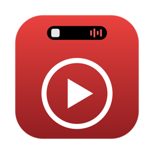
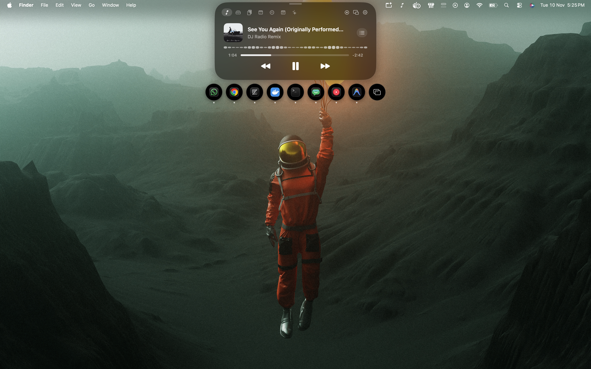
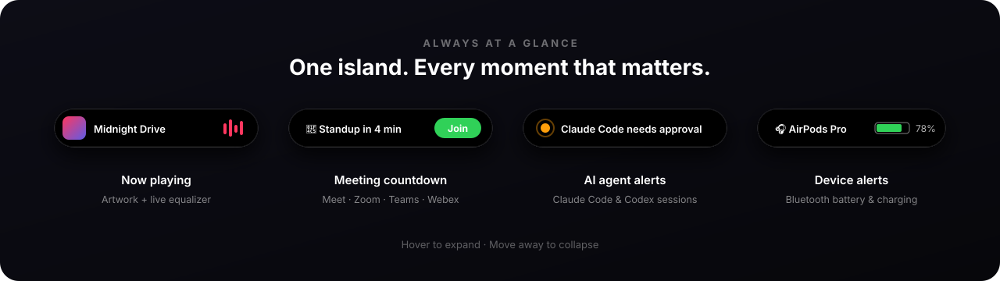

<div align="center">



# Notchbeat

**A Dynamic Island for your desktop.**<br/>
Your music, meetings, clipboard and system stats in one pill at the top of your screen.

[](#-macos)
[](#-windows)
[](../../actions/workflows/build-windows.yml)

[**Install**](#-install) · [**Features**](#-features) · [**Shortcuts**](#%EF%B8%8F-shortcuts) · [**Privacy**](#-privacy) · [**Troubleshooting**](#-troubleshooting)

<br/>



</div>

<br/>

Notchbeat puts a small black pill at the top center of your screen. It shows the song you're playing, and when you hover over it, it opens into a full control center: playback controls, an app switcher, clipboard history, upcoming meetings with a one-click **Join** button, live system stats, a file shelf, quick notes, and alerts from your AI coding agents.

Move the mouse away and it shrinks back down.

<div align="center">

</div>

<br/>

## 🚀 Install

<table>
<tr>
<td width="50%" valign="top">

### 🪟 Windows

**Download the app (no setup needed)**

1. Open the **[Build Windows Exe](../../actions/workflows/build-windows.yml)** page.
2. Click the latest run with a green ✅.
3. Scroll to **Artifacts** and download **`Notchbeat-Windows-x64`**.
4. Unzip it and double-click **`Notchbeat.exe`**.

> [!TIP]
> If Windows SmartScreen says *"Windows protected your PC"*, click **More info → Run anyway**. The app isn't code-signed yet.

The `.exe` is self-contained. You don't need to install .NET or anything else.

</td>
<td width="50%" valign="top">

### 🍎 macOS

**Requires** macOS 14 Sonoma or newer (Apple Silicon or Intel) and Google Chrome with [YouTube Music](https://music.youtube.com).

1. Install Apple's command-line tools (one time):
   ```bash
   xcode-select --install
   ```
2. Clone the repo and install the app:
   ```bash
   git clone https://github.com/navaneeth-s-murali/Notchbeat.git
   cd Notchbeat
   ./build.sh install
   ```
3. Open **Notchbeat** from Applications.

</td>
</tr>
</table>

### One-time setup on macOS

| Step | What to do |
| :--: | --- |
| **1** | In Chrome, click a normal browser window, then turn on **View → Developer → Allow JavaScript from Apple Events** in the menu bar. |
| **2** | When macOS asks *"Notchbeat wants to control Google Chrome"*, click **Allow**. |
| **3** | *(Optional)* To switch between individual windows, turn Notchbeat on in **System Settings → Privacy & Security → Accessibility**. |

On Windows there's no setup. Notchbeat reads the system media controls, so it works with Chrome, Edge, Spotify, YouTube Music and other players right away.

<details>
<summary><b>Share a ready-made Mac app with a friend</b></summary>

<br/>

```bash
./build.sh share
```

This creates `~/Desktop/Notchbeat.zip` with the app and a short install guide. Your friend drags the app into Applications. The first time they open it, macOS will say it can't be verified. They need to go to **System Settings → Privacy & Security** and click **Open Anyway**.

</details>

<details>
<summary><b>Build the Windows app from source</b></summary>

<br/>

1. Install the [.NET 8 SDK](https://dotnet.microsoft.com/download/dotnet/8.0).
2. In the `windows` folder, double-click **`build.bat`**, or run:
   ```cmd
   dotnet publish Notchbeat/Notchbeat.csproj -c Release -r win-x64 --self-contained true -p:PublishSingleFile=true -o build
   ```
3. The app is built to `windows\build\Notchbeat.exe`.

</details>

<br/>

## ✨ Features

<table>
<tr>
<td width="33%" valign="top">

### 🎵 Now Playing
Artwork, title, artist and a progress bar you can drag to jump around the song. Play, pause and skip, plus an **Up Next** queue.

</td>
<td width="33%" valign="top">

### 🫧 App Switcher
Round bubbles for your open apps. Click one to switch to it. A number on a bubble means the app has several windows, and you can pick one.

</td>
<td width="33%" valign="top">

### 📋 Clipboard History
Keeps your last 60 copied texts, links and files. Skips passwords copied from password managers. Open it from anywhere with a shortcut.

</td>
</tr>
<tr>
<td valign="top">

### 📅 Calendar
Shows today's and tomorrow's meetings. Google Meet, Zoom, Teams and Webex meetings get a green **Join** button, and a countdown appears 10 minutes before they start.

</td>
<td valign="top">

### 📊 System & Battery
Live graphs for CPU, memory and network, plus battery level. Also shows the battery of AirPods, headphones, keyboards and mice.

</td>
<td valign="top">

### 📁 File Shelf
Drag a file to the top of the screen to keep it in the island, then drag it out wherever you need it. On macOS you can also drop files on it to send them with AirDrop.

</td>
</tr>
<tr>
<td valign="top">

### 📝 Notes
A quick scratchpad that saves as you type. On macOS you can send your notes to Apple Notes.

</td>
<td valign="top">

### 🤖 AI Agent Monitor
Shows when **Claude Code** or **Codex** is working, waiting for your approval, or done, and plays a sound when it needs you.

</td>
<td valign="top">

### 🖼️ Mini Player
A small floating player you can drag anywhere, in three sizes. On a Mac you can swipe with two fingers to skip songs.

</td>
</tr>
</table>

<br/>

## ⌨️ Shortcuts

| Action | macOS | Windows |
| --- | :---: | :---: |
| Open clipboard history | <kbd>⌘</kbd> <kbd>⇧</kbd> <kbd>V</kbd> | <kbd>Ctrl</kbd> <kbd>Shift</kbd> <kbd>V</kbd> |
| Choose an item | <kbd>↑</kbd> <kbd>↓</kbd> then <kbd>Return</kbd> | Click it |
| Paste item 1 to 9 directly | <kbd>1</kbd> … <kbd>9</kbd> | — |
| Close | <kbd>Esc</kbd> | — |

**Tips:** Right-click an app bubble to pin it. Use the ⚙ button in the island to choose a glass or black style, a highlight color, which tabs to show, and whether Notchbeat starts when you log in.

<br/>

## 🔒 Privacy

- **Everything stays on your computer.** Notchbeat has no account, no analytics and no server.
- For music, it only reads the song details shown on the player and presses its buttons. It never touches your Google account or passwords.
- Clipboard history skips passwords from password managers. On macOS, copied images are forgotten when you quit the app. You can turn clipboard history off at any time.
- The AI agent monitor only reads local log files.

<br/>

## 🛠 Troubleshooting

<details>
<summary><b>The island says "Setup needed"</b></summary>
<br/>
Click it and follow the steps. On macOS this usually means Chrome's <b>Allow JavaScript from Apple Events</b> setting is turned off.
</details>

<details>
<summary><b>Nothing shows up</b></summary>
<br/>
Make sure a song is actually playing. On macOS, check that YouTube Music is open in Chrome and that <b>View → Developer → Allow JavaScript from Apple Events</b> has a tick next to it.
</details>

<details>
<summary><b>macOS says the app "cannot be verified"</b></summary>
<br/>
Go to <b>System Settings → Privacy & Security</b>, scroll down and click <b>Open Anyway</b> next to Notchbeat. You only need to do this once.
</details>

<details>
<summary><b>Windows SmartScreen blocks the app</b></summary>
<br/>
Click <b>More info → Run anyway</b>. This happens because the app isn't code-signed.
</details>

<br/>

## 🧱 Built with

| | macOS | Windows |
| --- | --- | --- |
| **Language** | Swift + SwiftUI | C# + WPF (.NET 8) |
| **Music** | Chrome JavaScript bridge | System Media Transport Controls |
| **Package** | Universal binary (`arm64` + `x86_64`) | Single self-contained `.exe` |

<br/>

<div align="center">
<sub>The images above are design illustrations of the Notchbeat interface.</sub><br/>
<sub>Made with ♪ for people who like to keep an eye on their music.</sub>
</div>
# automation_test
# Notchbeat
